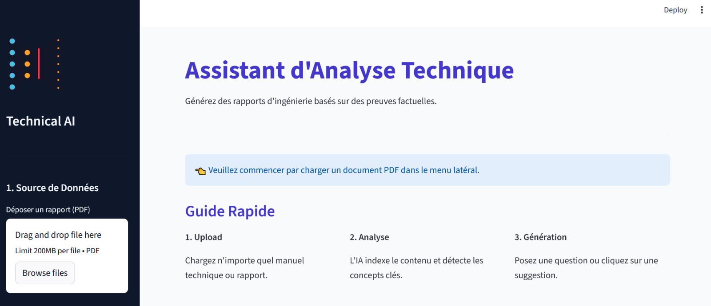

# AI Technical Report Assistant — RAG Architecture

An intelligent assistant that **answers questions and generates technical reports from private PDF documents**, grounding every answer in the source text to limit LLM hallucinations — built with a **Retrieval-Augmented Generation (RAG)** pipeline.

> Team project (3 students) — ENSA Fez (GSCSI), December 2025.

    



---

## Why RAG?

Generic LLMs used directly on technical documentation have two critical limits:

- **Hallucination** — invented, unsourced facts, unacceptable for engineering data;
- **No traceability** — answers cannot be checked against the original documents.

RAG fixes both: the model only answers from passages retrieved in the user's own documents.

## Pipeline

```
PDF ──► PyPDFLoader ──► chunking with overlap ──► Hugging Face embeddings ──► FAISS index
                                                       (all-MiniLM-L6-v2, local)
Question ──► embedding ──► FAISS top-k similar chunks ──► Llama 3 (70B) via Groq ──► grounded answer / report
                                                                                     │
                                                                              Streamlit interface
```

1. **Loading** — text extracted from PDFs with LangChain's `PyPDFLoader`.
2. **Chunking with overlap** — so an idea spanning two chunks is not lost.
3. **Vectorisation** — Hugging Face `all-MiniLM-L6-v2` embeddings, **run locally**: documents never leave the machine for indexing.
4. **Indexing & retrieval** — FAISS finds the k most similar chunks to the question.
5. **Generation** — Llama 3 (70B) served by **Groq** (LPU hardware) for very low latency.
6. **Interface** — Streamlit web app: PDF upload, analysis dashboard, report generator.

## Design choices

| Choice | Reason |
|---|---|
| Local embeddings + FAISS | Confidentiality of private documents, fast similarity search |
| Llama 3 via Groq | Open-source state-of-the-art model, reports generated in seconds |
| LangChain | Chains the loader, splitter, embeddings, vector store and LLM |
| Streamlit | Turns a Python script into a usable web app quickly |

## Tech stack

Python · LangChain · PyPDFLoader · sentence-transformers / Hugging Face · FAISS · Llama 3 (70B) · Groq API · Streamlit

---

**Author:** Khaoula Belhaj (with two teammates) — final-year engineering student, Communicating Systems & Computer Security, ENSA Fez · [LinkedIn](https://linkedin.com/in/khaoula-belhaj-1999163a6)
